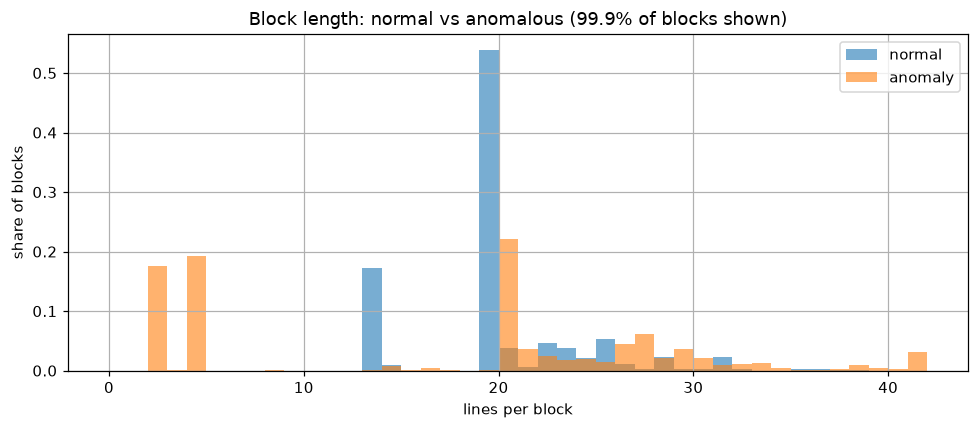
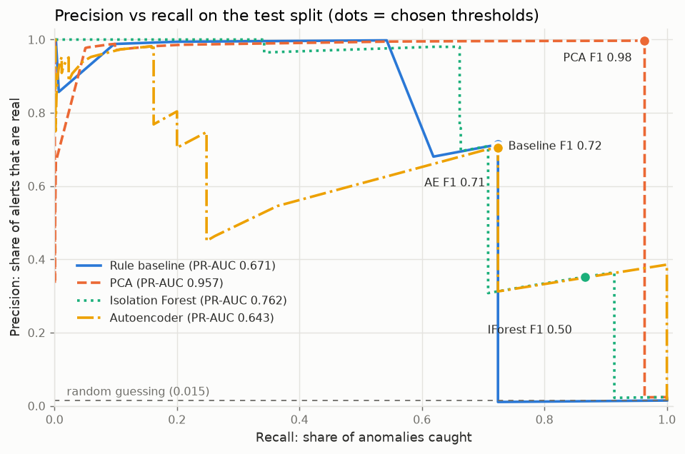

# Log Anomaly Detection

[](https://github.com/dvolaid-oss/log-anomaly-detection/actions/workflows/ci.yml)


An end-to-end, **unsupervised** pipeline that reads system logs, learns what "normal"
looks like, flags anomalies, and **explains why** each one was flagged.

It is benchmarked on the public [LogHub](https://github.com/logpai/loghub) datasets
(HDFS, BGL) and extended to **security logs** (SSH brute-force detection).

> 🚧 **Work in progress.** See the [roadmap](#roadmap) for status.

## How it works

```
 raw logs ──► [ingest] ──► [parse: Drain] ──► [features] ──► [models] ──► [evaluate] ──► reports/
  (HDFS,        load,        templates +       event-count     baseline,     precision,
   BGL,         normalize     event IDs         matrix per      PCA,          recall, F1,
   auth.log)    to common                      block/window,   IsoForest,    PR curves,
                schema                         TF-IDF option   Autoencoder   comparison
                                                                    │
                                                                    ▼
                                          [explain] ──► Streamlit dashboard
```

1. **Adapters** convert each log format into one common schema
   (`timestamp, source, level, message, group_id, label`), so everything downstream
   is dataset-agnostic.
2. **Drain** turns millions of raw lines into a few dozen event templates.
3. **Features:** event counts per session (HDFS block) or time window (BGL).
4. **Models** are trained without labels: a rule baseline, PCA, Isolation Forest,
   and an autoencoder, all behind one `fit / score / predict` interface.
5. **Evaluation** uses the labels only here: precision, recall, F1, PR curves.
6. **Explanations** say why each anomaly was flagged, shown in a Streamlit dashboard.

## Data

[LogHub HDFS_v1](https://github.com/logpai/loghub): 11.2M log lines from a Hadoop cluster,
grouped into 575,061 blocks (sessions), of which **2.93% are labelled anomalous**.
Downloaded by `logad download` from Zenodo with checksum verification (see [data/README.md](data/README.md)).

Exploratory analysis: [notebooks/01_exploration.ipynb](notebooks/01_exploration.ipynb). Key findings:

- Only INFO/WARN levels: anomalies must be found from patterns, not error messages.
- A "flag any WARN" rule fails: 48% of anomalous blocks have a WARN, but so do 23% of normal ones.
- Short blocks are suspicious: no normal block has under 13 lines, but 37% of anomalous blocks do.
- Some message types are strong signals (e.g. one appears in 30% of anomalous vs 0.04% of normal blocks).
- ~10M distinct messages reduce to under 100 templates → a log parser is essential.



## Parsing

`logad parse` turns each message into a template (event ID): regex **masking** of known
variables (block IDs, IPs, numbers), then the **Drain** algorithm groups what's left.

| | Result |
|---|---|
| Accuracy on LogHub's hand-labelled 2k sample | **100% grouping accuracy**, 14 of 14 templates |
| Full HDFS: 11.2M lines (10.3M distinct messages) | **45 templates in ~7 s** |

Speed trick: Drain only sees the masked text, so it reads each *distinct* masked message once
(86 for HDFS) and DuckDB maps the results back to all 11.2M lines. LogHub's reference list has
29 templates; our extra ones are rare Java-exception variants (< 0.1% of lines each).
Full table: [reports/hdfs/templates.md](reports/hdfs/templates.md).

## Features

`logad features` turns each block into a row of event counts: a **575,061 × 45 matrix**,
built in ~8 s. Blocks are split **by time** so models learn from the past and are judged on
the future:

| Split | Blocks | Anomaly % | Used for |
|-------|-------:|----------:|----------|
| train (oldest 60%) | 345,037 | 3.23 | fitting models (labels never read) |
| validation (next 20%) | 115,012 | 3.48 | choosing alert thresholds |
| test (newest 20%) | 115,012 | 1.46 | final, untouched evaluation |

The anomaly rate drops in the test period: a realistic shift that makes precision harder.
Optional TF-IDF weighting (rare events count more) and scaling are learned on the train split only.

## Models

`logad train` fits each detector on the **train split only, without labels**, and scores
every block. All models share one interface (`fit`, `score`, `predict`), so they're swappable.

| Model | Idea | Fit time | Validation ROC-AUC | Validation PR-AUC |
|-------|------|---------:|-------------------:|------------------:|
| Rule baseline | score = rarity of the block's rarest event | 0.1 s | 0.889 | 0.810 |
| PCA (Xu et al. 2009) | error when rebuilding the block from 5 "normal" patterns (TF-IDF input) | 0.6 s | 0.981 | 0.859 |
| Isolation Forest | how quickly random splits isolate the block | 0.6 s | 0.987 | 0.807 |
| Autoencoder (PyTorch) | error when a 45 → 32 → 8 → 32 → 45 network rebuilds the block | 16 s | **0.996** | **0.872** |

PR-AUC of random guessing is 0.035 (the share of anomalies). These are quick, threshold-free
checks on the validation split; the test split stays untouched until the final evaluation.
Isolation Forest can't see events that never occurred in training (2 such events in HDFS,
all 8 blocks containing them are anomalous); the baseline and PCA can.

## Results

Final evaluation on the **test split** (newest 20% of blocks: 115,012 blocks, 1.46% anomalous),
**evaluated once**. Models never saw labels; each alert threshold was chosen on the
validation split (best F1), the only place labels influence the system.
Brackets: 95% bootstrap confidence intervals.

| Model | Precision | Recall | F1 | Caught | False alarms | Missed |
|-------|----------:|-------:|---:|-------:|-------------:|-------:|
| Rule baseline | 0.714 | 0.724 | 0.719 [0.700–0.735] | 1,216 | 488 | 463 |
| **PCA** | **0.997** | **0.964** | **0.980** [0.975–0.985] | 1,618 | **5** | 61 |
| Isolation Forest | 0.352 | 0.866 | 0.501 [0.486–0.516] | 1,454 | 2,673 | 225 |
| Autoencoder (PyTorch) | 0.705 | 0.724 | 0.714 [0.696–0.731] | 1,216 | 509 | 463 |

- **PCA wins clearly:** 96% of anomalies caught with only 5 false alarms in 113,333 normal blocks.
  Its interval doesn't overlap the others, so the gap is not luck.
- **Isolation Forest's threshold didn't survive the move to new data:** F1 0.825 on validation
  but 0.501 on test. A big group of normal blocks scores just below its threshold, and in the
  test period many of them land just above it (2,673 false alarms). A fragile threshold under
  time drift is a real production risk, and exactly what a time-based split is meant to expose.
- **The simple rule baseline beats Isolation Forest on F1** (0.719 vs 0.501). Always build one.
- **The autoencoder (a small neural network) didn't beat PCA.** It had the best validation
  scores (ROC-AUC 0.996), but on test it missed 463 anomalies, and they are all the *same*
  2-line block: a write that died right after starting ("receiving block" + "allocate block").
  It rebuilds such tiny blocks easily, so they look normal to it (the rule baseline misses the
  same 463). PCA catches all of them: it learned that normal blocks contain events in fixed
  proportions, so it also notices **expected events that are missing**, not just unusual ones
  that are present. The simpler, linear model wins here.



Full report: [reports/hdfs/results.md](reports/hdfs/results.md) ·
score distributions: [reports/hdfs/score_distributions.png](reports/hdfs/score_distributions.png)

## Quickstart (Windows, PowerShell)

```powershell
git clone https://github.com/dvolaid-oss/log-anomaly-detection.git
cd log-anomaly-detection
python -m venv .venv
.venv\Scripts\Activate.ps1
pip install -r requirements-dev.txt
pip install -e . --no-deps

logad --help          # list pipeline commands
pytest                # run the tests

logad download --config configs/hdfs.yaml   # 187 MB from Zenodo, checksum-verified
logad ingest   --config configs/hdfs.yaml   # raw logs → artifacts/hdfs/logs.parquet (~1 min)
logad parse    --config configs/hdfs.yaml   # messages → templates, artifacts/hdfs/events.parquet
logad features --config configs/hdfs.yaml   # event-count matrix per block + time-based splits
pip install -r requirements-torch.txt      # optional: CPU-only PyTorch for the autoencoder
logad train    --config configs/hdfs.yaml   # fit baseline, PCA, Isolation Forest, autoencoder
logad evaluate --config configs/hdfs.yaml   # thresholds on validation, final metrics on test

logad run-all  --config configs/hdfs.yaml   # or: every step above in one command
```

Full setup guide: [docs/setup-windows.md](docs/setup-windows.md).

## Project structure

```
configs/          dataset configs (paths, window sizes, hyperparameters)
src/logad/        the Python package: adapters, parsing, features, models, evaluation, explain, cli
app/              Streamlit dashboard
notebooks/        exploratory data analysis
tests/            pytest suite
data/, artifacts/ raw data and generated files (not committed)
```

## Roadmap

| # | Stage | Status |
|---|-------|--------|
| 0 | Setup, scaffold, CI | ✅ |
| 1 | Data download + HDFS adapter + EDA | ✅ |
| 2 | Parsing with Drain | ✅ |
| 3 | Features (event counts, TF-IDF) | ✅ |
| 4 | Models: baseline, PCA, Isolation Forest | ✅ |
| 5 | Evaluation + results table | ✅ |
| 6 | Autoencoder (PyTorch) | ✅ |
| 7 | Explanations + Streamlit dashboard | ⏳ |
| 8 | BGL (time windows) | ⏳ |
| 9 | Security logs: SSH brute-force detection | ⏳ |
| 10 | Polish | ⏳ |

## License

[MIT](LICENSE)
