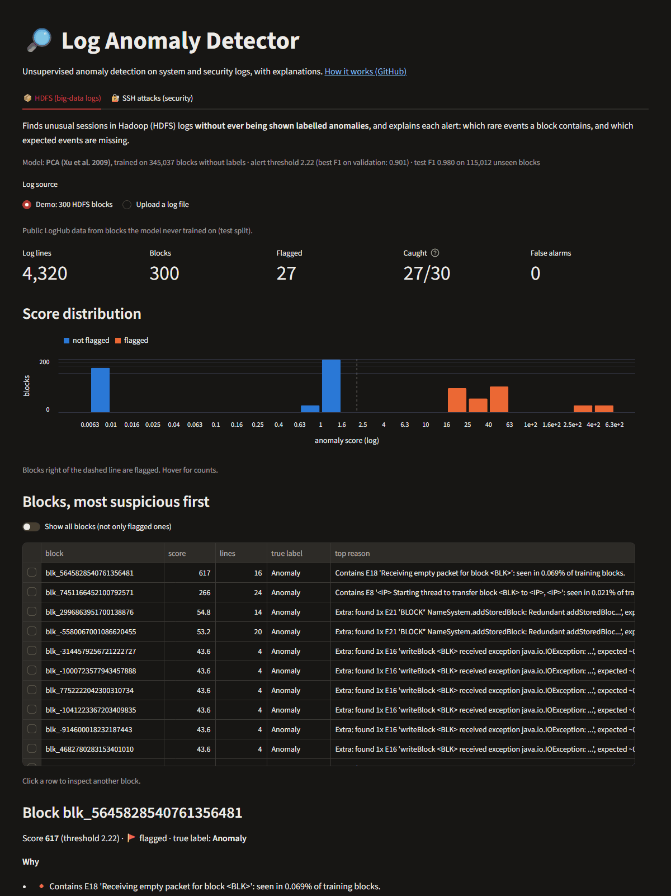
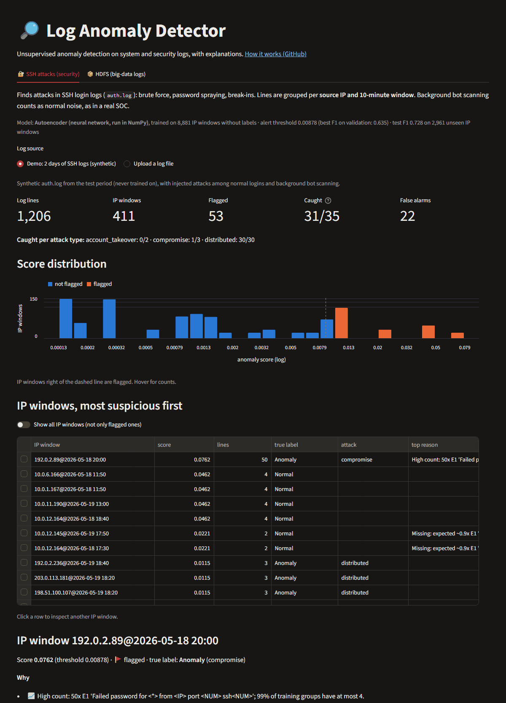
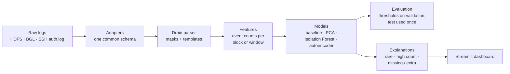
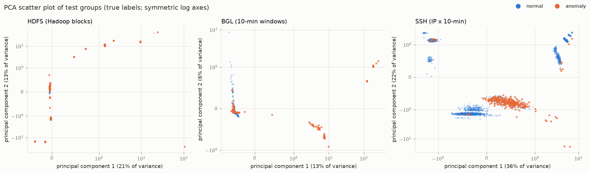
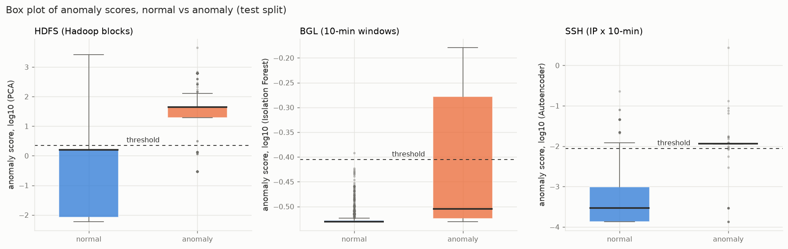
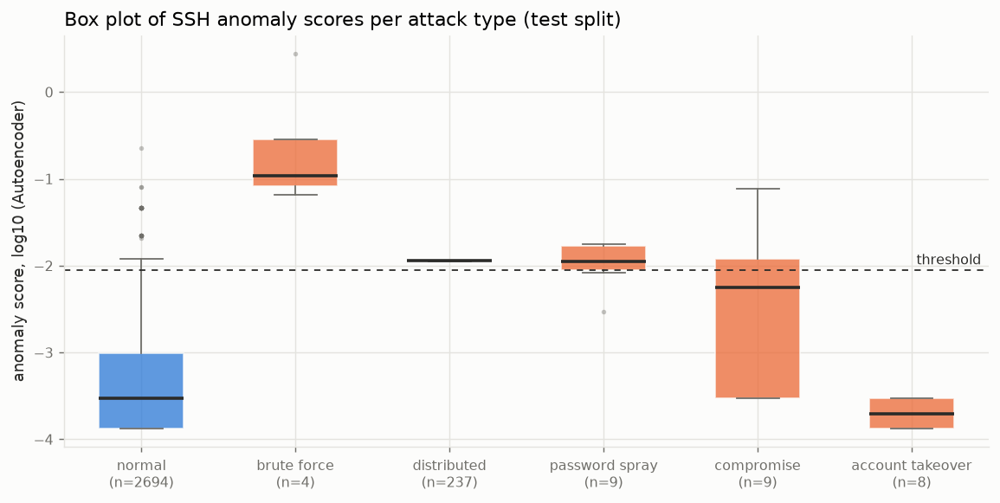
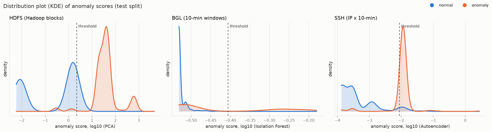
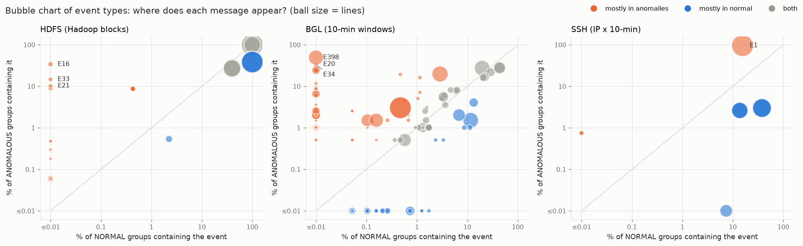

# Log Anomaly Detection

[](https://github.com/dvolaid-oss/log-anomaly-detection/actions/workflows/ci.yml)


An end-to-end, **unsupervised** pipeline that reads raw system and security logs, learns what
"normal" looks like **without ever seeing a labelled anomaly**, flags what's unusual, and
**explains in plain words why** each alert was raised.

Benchmarked on two public [LogHub](https://github.com/logpai/loghub) datasets (HDFS: 11.2M
lines; BGL: 4.7M lines) and extended to **SSH attack detection** (brute force, password
spraying, break-ins) on a synthetic `auth.log`, with honest evaluation throughout: time-based
splits, thresholds chosen on validation, and each test split used exactly once.

> **[▶ Live demo](https://log-anomaly-detection-nzno5mxmwpjotewlg6eyqm.streamlit.app/)**: try the dashboard in your browser, with an HDFS tab and an SSH
> attacks tab (free host; if it's asleep, click "wake up" and wait ~30 s).

| HDFS tab: anomalies in big-data logs | SSH tab: attacks in login logs |
|:---:|:---:|
| [](https://log-anomaly-detection-nzno5mxmwpjotewlg6eyqm.streamlit.app/) | [](https://log-anomaly-detection-nzno5mxmwpjotewlg6eyqm.streamlit.app/?tab=auth) |

**Contents:** [Results at a glance](#results-at-a-glance) ·
[How it works](#how-it-works) · [Normal vs anomaly](#normal-data-vs-anomaly-data) ·
[Visual results](#visual-results) · [HDFS](#hdfs-the-main-benchmark) ·
[BGL](#second-dataset-bgl-does-it-generalise) ·
[SSH security](#security-twist-ssh-brute-force-and-break-in-detection) ·
[Dashboard](#dashboard) · [What I learned](#what-i-learned) · [Limitations](#limitations) ·
[Future work](#future-work) · [Quickstart](#quickstart-windows-powershell)

## Results at a glance

F1 on each dataset's **test split** (data from a later period than training, evaluated once).
Thresholds were chosen on the validation split; models never saw labels.

| Model | HDFS<br>(Hadoop blocks) | BGL<br>(supercomputer, 10-min windows) | SSH auth.log<br>(synthetic, IP × 10-min) |
|-------|:-----:|:-----:|:-----:|
| Rule baseline (rarest event) | 0.719 | 0.205 | 0.407 |
| PCA (Xu et al. 2009) | **0.980** | 0.204 | 0.165 |
| Isolation Forest | 0.501 | **0.511** | 0.382 |
| Autoencoder (PyTorch) | 0.714 | 0.207 | **0.728** |

**Three datasets, three different winners.** PCA finds HDFS anomalies where expected events
are *missing* (F1 0.980, 5 false alarms in 113,333 normal blocks); Isolation Forest isolates
BGL's extreme bursts; the autoencoder separates SSH attacks from background bot noise. The
lesson, and the reason this pipeline keeps models swappable and compares them identically:
**there is no single best detector**. Details and confidence intervals are in each section below.

## How it works



1. **Adapters** convert each log format into one common schema
   (`timestamp, source, level, message, group_id, label`), so everything downstream
   is dataset-agnostic.
2. **Drain** turns millions of raw lines into a few dozen event templates.
3. **Features:** event counts per session (HDFS block), time window (BGL) or source IP
   per time window (SSH).
4. **Models** are trained without labels: a rule baseline, PCA, Isolation Forest,
   and an autoencoder, all behind one `fit / score / predict` interface.
5. **Evaluation** uses the labels only here: precision, recall, F1, PR curves.
6. **Explanations** say why each anomaly was flagged, shown in a Streamlit dashboard.

## Normal data vs anomaly data

Before the charts, what are we actually separating? In every dataset the logs are cut into
**groups** (an HDFS block, a BGL 10-minute window, or one IP's 10 minutes of SSH activity),
and each group is **normal** or an **anomaly**. All numbers below come from the test splits.

| | HDFS (Hadoop file system) | BGL (supercomputer) | SSH logins (synthetic) |
|---|---|---|---|
| **One group is** | one data block | 10 minutes of the whole machine | one source IP for 10 minutes |
| **Anomalies** | 1.46% of 115,012 blocks | 9.33% of 2,111 windows | 9.02% of 2,961 IP windows |
| **Normal looks like** | a block is received, stored on 3 machines and confirmed: a fixed pattern (median 13 lines) | routine hardware messages, mostly "error detected and corrected" (median 11 lines) | an employee logs in with a key from their usual machine, or a bot tries `root` / `test` a few times (median 2 lines) |
| **Anomaly looks like** | a write that died after 2 lines, or an exception such as "Could not read from stream" (median 4 lines) | an alert burst, e.g. "machine check interrupt" (median **238** lines) | dozens of failed passwords from one IP, or failures followed by a successful login |

**HDFS: a normal block** (13 lines; the full, healthy write of a 64 MB block):
```
Receiving block blk_6013400702092009149 src: /10.251.203.149:45061 dest: /10.251.203.149:50010
BLOCK* NameSystem.allocateBlock: /user/root/rand8/_temporary/.../part-01601. blk_6013400702092009149
Receiving block blk_6013400702092009149 src: /10.251.111.80:58379 dest: /10.251.111.80:50010
PacketResponder 0 for block blk_6013400702092009149 terminating
Received block blk_6013400702092009149 of size 67108864 from /10.251.111.80
BLOCK* NameSystem.addStoredBlock: blockMap updated: 10.251.71.97:50010 is added to blk_6013400702092009149
...  (7 more lines: every copy confirmed)
```
**HDFS: an anomalous block** (only 2 lines: the write started and then nothing, no
"Received", no "PacketResponder", no "addStoredBlock"; the *missing* events are the signal):
```
Receiving block blk_-5330593813049053889 src: /10.251.27.63:35753 dest: /10.251.27.63:50010
BLOCK* NameSystem.allocateBlock: /user/root/rand6/_temporary/.../part-01821. blk_-5330593813049053889
```

**BGL: normal vs anomaly.** Each raw line starts with its label: `-` is normal, a word such
as `KERNMC` (kernel machine check) names an alert. The level word alone doesn't decide it:
the first two lines below say **FATAL** yet are labelled normal; only the third is an alert.
The project removes this first word before any model sees the data (a classic leakage trap).
```
-      ... R70-M0-NC-C:J16-U01 RAS KERNEL FATAL instruction address: 0x0014c994
-      ... R70-M0-NC-C:J16-U01 RAS KERNEL FATAL machine check status register: 0x82000000
KERNMC ... R70-M0-NC-C:J16-U01 RAS KERNEL FATAL machine check interrupt
```

**SSH: normal** (an employee logging in; and a background bot, which is normal noise):
```
May 18 13:38:18 web01 sshd[28900]: Accepted publickey for lucas from 10.0.4.7 port 57080 ssh2
May 28 07:51:25 web01 sshd[53642]: Failed password for invalid user test from 203.0.113.239 port 56465 ssh2
```
**SSH: an attack** (133 lines in 10 minutes from one IP, all against one account):
```
May 22 13:26:19 web01 sshd[34912]: Failed password for erin from 198.51.100.74 port 43386 ssh2
May 22 13:26:20 web01 sshd[24687]: Failed password for erin from 198.51.100.74 port 55933 ssh2
May 22 13:26:22 web01 sshd[43896]: Failed password for erin from 198.51.100.74 port 39865 ssh2
...
```

The models never see these labels. They learn only what is *common*, and the labels are
used afterwards to check them. The charts below show how well "uncommon" matches "anomaly".

## Visual results

Five figures, generated by `logad charts` from the **test split** of each dataset (data the
models never trained on). Blue is always normal, orange is always anomaly. Box and
distribution plots use each dataset's best model on validation (HDFS: PCA, BGL: Isolation
Forest, SSH: autoencoder). Scores are drawn on a log scale because they span many orders of
magnitude.

### 1. Scatter plot (PCA projection)



**What it shows.** Each dot is one group, described by how often each event type occurs in
it. That's 10 to 438 numbers per group, too many to draw, so **PCA** (Principal Component
Analysis) squeezes them into the two directions that vary the most in the training data.
Dots close together are groups with similar activity.

**How to read it.** If anomalies (orange) form their own region, they're easy to separate.
If orange dots sit inside the blue cloud, the two look alike. The axes use a symmetric log
scale (so the dense centre and far-out groups both fit), groups with identical counts get a
tiny random offset so they don't hide each other, and for HDFS a random 4,000 of the 113,333
normal blocks are drawn (all 1,679 anomalies are).

**What it tells us.** **SSH**: attacks form a clear cloud of their own, so most attacks are
easy to tell apart. **BGL**: many anomalous windows sit far away from the normal ones (the
huge alert bursts), but some overlap the normal cluster: those are the hard ones to
catch. **HDFS**: in only 2 dimensions many anomalies overlap normal blocks; the PCA
*detector* uses more dimensions plus the rebuilding error, which is how it still separates
96% of them. A flat picture never shows everything a model uses.

### 2. Box plot (box-and-whisker plot)



**What it shows.** The anomaly scores of normal and anomalous groups. The box holds the
middle 50% of groups, the thick line is the median (the middle value), the whiskers reach
the typical range, and dots are unusual groups. The dashed line is the alert threshold.

**How to read it.** Everything above the threshold raises an alert. A good detector puts the
blue box below the line and the orange box above it.

**What it tells us.** **HDFS**: the boxes don't overlap at all: the median anomaly scores
43.6 vs 1.6 for normal blocks; 96.4% of anomalies are above the threshold and only 0.004% of
normal blocks are. **BGL**: the orange box straddles the threshold: only 34.5% of anomalies
are above it, which is why BGL recall is low. **SSH**: 94.4% of attack windows are above the
threshold, but so are 6.4% of normal windows; that's the 173 false alarms.



**Per attack type (SSH).** One box per attack, next to normal windows. **Brute force** scores
highest (all 4 windows caught), **distributed** and **password spraying** sit just above the
threshold (100% and 78% caught), **compromise** straddles it (44%), and **account takeover**
sits entirely *inside the normal range* (0%). A single quiet night-time login looks like any
normal login when you only count events. That's this project's clearest limitation, and the
reason "per-user behaviour features" is the first item under Future work.

### 3. Distribution plot (KDE density curves)



**What it shows.** The same scores as smooth curves (**KDE**, Kernel Density Estimate: a
smoothed histogram). The height shows where most groups of each kind lie; each curve is
scaled on its own, so the small anomaly class is as visible as the big normal one.

**How to read it.** Where the two curves don't overlap, the model is sure. Where they
overlap, mistakes happen: orange to the left of the threshold are missed anomalies, blue to
its right are false alarms.

**What it tells us.** **HDFS**: two almost separate hills; the threshold sits in the empty
valley between them (61 missed, 5 false alarms). **BGL**: the normal curve is one sharp spike
on the left, but the anomaly curve is long and flat and starts in that same spike, so 129 of
197 anomalies are missed; only 1 false alarm. **SSH**: the attack curve is a tall narrow peak
right at the threshold: most attacks are caught, but a small bump of normal windows sits there
too (173 false alarms). Moving the threshold trades one kind of mistake for the other.

### 4. Bubble chart (event types)



**What it shows.** Each ball is one **event type** (one log template). Its position says how
often it appears in normal groups (x) vs anomalous groups (y); its size is how many lines it
has. Both axes are logarithmic; "≤0.01" means "(almost) never".

**How to read it.** Balls on the grey diagonal appear equally in both. Balls in the
**top-left** (orange) appear in anomalies but almost never in normal groups: those messages
give anomalies away. Balls below the diagonal (blue) belong to normal activity.

**What it tells us.** **HDFS** has clear give-aways: **E16** "writeBlock … received
exception: Could not read from stream" appears in 34% of anomalous blocks and in no normal
block, **E33** "Unexpected error trying to delete block" in 15%, **E21** "Redundant
addStoredBlock request" in 10%. **BGL** has many (194 of 259 event types lean towards
anomalies), led by **E398** "ciod: Error reading message prefix…" (49% of anomalous windows)
and **E20** "machine check". **SSH** has just one: **E1** "Failed password for …" appears in
96% of attack windows but also in 16% of normal ones, because bots fail passwords too. That
overlap is why SSH detection needs *how many* failures (bursts), not just *whether* they occur.

## HDFS: the main benchmark

### Data

[LogHub HDFS_v1](https://github.com/logpai/loghub): 11.2M log lines from a Hadoop cluster,
grouped into 575,061 blocks (sessions), of which **2.93% are labelled anomalous**.
Downloaded by `logad download` from Zenodo with checksum verification (see [data/README.md](data/README.md)).

Exploratory analysis: [notebooks/01_exploration.ipynb](notebooks/01_exploration.ipynb). Key findings:

- Only INFO/WARN levels: anomalies must be found from patterns, not error messages.
- A "flag any WARN" rule fails: 48% of anomalous blocks have a WARN, but so do 23% of normal ones.
- Short blocks are suspicious: no normal block has under 13 lines, but 37% of anomalous blocks do.
- Some message types are strong signals (e.g. one appears in 30% of anomalous vs 0.04% of normal blocks).
- ~10M distinct messages reduce to under 100 templates → a log parser is essential.


### Parsing

`logad parse` turns each message into a template (event ID): regex **masking** of known
variables (block IDs, IPs, numbers), then the **Drain** algorithm groups what's left.

| | Result |
|---|---|
| Accuracy on LogHub's hand-labelled 2k sample | **100% grouping accuracy**, 14 of 14 templates |
| Full HDFS: 11.2M lines (10.3M distinct messages) | **45 templates in ~7 s** |

Speed trick: Drain only sees the masked text, so it reads each *distinct* masked message once
(86 for HDFS) and DuckDB maps the results back to all 11.2M lines. LogHub's reference list has
29 templates; our extra ones are rare Java-exception variants (< 0.1% of lines each).
Full table: [reports/hdfs/templates.md](reports/hdfs/templates.md).

### Features

`logad features` turns each block into a row of event counts: a **575,061 × 45 matrix**,
built in ~8 s. Blocks are split **by time** so models learn from the past and are judged on
the future:

| Split | Blocks | Anomaly % | Used for |
|-------|-------:|----------:|----------|
| train (oldest 60%) | 345,037 | 3.23 | fitting models (labels never read) |
| validation (next 20%) | 115,012 | 3.48 | choosing alert thresholds |
| test (newest 20%) | 115,012 | 1.46 | final, untouched evaluation |

The anomaly rate drops in the test period: a realistic shift that makes precision harder.
Optional TF-IDF weighting (rare events count more) and scaling are learned on the train split only.

### Models

`logad train` fits each detector on the **train split only, without labels**, and scores
every block. All models share one interface (`fit`, `score`, `predict`), so they're swappable.

| Model | Idea | Fit time | Validation ROC-AUC | Validation PR-AUC |
|-------|------|---------:|-------------------:|------------------:|
| Rule baseline | score = rarity of the block's rarest event | 0.1 s | 0.889 | 0.810 |
| PCA (Xu et al. 2009) | error when rebuilding the block from 5 "normal" patterns (TF-IDF input) | 0.6 s | 0.981 | 0.859 |
| Isolation Forest | how quickly random splits isolate the block | 0.6 s | 0.987 | 0.807 |
| Autoencoder (PyTorch) | error when a 45 → 32 → 8 → 32 → 45 network rebuilds the block | 16 s | **0.996** | **0.872** |

PR-AUC of random guessing is 0.035 (the share of anomalies). These are quick, threshold-free
checks on the validation split; the test split stays untouched until the final evaluation.
Isolation Forest can't see events that never occurred in training (2 such events in HDFS,
all 8 blocks containing them are anomalous); the baseline and PCA can.

### Results

Test split (newest 20% of blocks: 115,012 blocks, 1.46% anomalous),
**evaluated once**. Models never saw labels; each alert threshold was chosen on the
validation split (best F1), the only place labels influence the system.
Brackets: 95% bootstrap confidence intervals.

| Model | Precision | Recall | F1 | Caught | False alarms | Missed |
|-------|----------:|-------:|---:|-------:|-------------:|-------:|
| Rule baseline | 0.714 | 0.724 | 0.719 [0.700–0.735] | 1,216 | 488 | 463 |
| **PCA** | **0.997** | **0.964** | **0.980** [0.975–0.985] | 1,618 | **5** | 61 |
| Isolation Forest | 0.352 | 0.866 | 0.501 [0.486–0.516] | 1,454 | 2,673 | 225 |
| Autoencoder (PyTorch) | 0.705 | 0.724 | 0.714 [0.696–0.731] | 1,216 | 509 | 463 |

- **PCA wins clearly:** 96% of anomalies caught with only 5 false alarms in 113,333 normal blocks.
  Its interval doesn't overlap the others, so the gap is not luck.
- **Isolation Forest's threshold didn't survive the move to new data:** F1 0.825 on validation
  but 0.501 on test. A big group of normal blocks scores just below its threshold, and in the
  test period many of them land just above it (2,673 false alarms). A fragile threshold under
  time drift is a real production risk, and exactly what a time-based split is meant to expose.
- **The simple rule baseline beats Isolation Forest on F1** (0.719 vs 0.501). Always build one.
- **The autoencoder (a small neural network) didn't beat PCA.** It had the best validation
  scores (ROC-AUC 0.996), but on test it missed 463 anomalies, and they are all the *same*
  2-line block: a write that died right after starting ("receiving block" + "allocate block").
  It rebuilds such tiny blocks easily, so they look normal to it (the rule baseline misses the
  same 463). PCA catches all of them: it learned that normal blocks contain events in fixed
  proportions, so it also notices **expected events that are missing**, not just unusual ones
  that are present. The simpler, linear model wins here.


## Second dataset: BGL (does it generalise?)

[LogHub BGL](https://github.com/logpai/loghub): 4.7M lines from the **BlueGene/L
supercomputer**, a very different log type. It has **no sessions**, so lines are grouped into
**10-minute windows** (a window is anomalous if any line is an alert). The window size was
chosen on the training period only: 10 minutes keeps anomalies rare (10% of windows vs 55%
with 6-hour windows), which unsupervised detectors need. The adapter also removes a
**leakage trap**: each raw BGL line starts with its own label, which the model must never see.

Same code, new config: parsing reaches **96.85% grouping accuracy** on LogHub's labelled BGL
sample (438 templates on the full data). Test split (newest 20%: 2,111 windows, 9.3% anomalous),
evaluated once with the same settings as HDFS:

| Model | Precision | Recall | F1 [95% CI] | False alarms | Missed |
|-------|----------:|-------:|-------------|-------------:|-------:|
| Rule baseline | 0.115 | 0.939 | 0.205 [0.180–0.229] | 1,423 | 12 |
| PCA | 0.115 | 0.934 | 0.204 [0.178–0.228] | 1,420 | 13 |
| **Isolation Forest** | **0.986** | 0.345 | **0.511** [0.434–0.580] | **1** | 129 |
| Autoencoder | 0.118 | 0.863 | 0.207 [0.180–0.232] | 1,274 | 27 |

**BGL is much harder, and the ranking flips:** PCA (best on HDFS) is now among the weakest,
Isolation Forest (worst on HDFS) is the best. Why (analysis only, nothing tuned on test):

- **"Rare" isn't "bad" here.** BGL has a long tail of rare but harmless messages, so methods
  that flag rarity or unusual mixes raise ~1,400 false alarms.
- **The training data isn't clean.** 10% of training windows are anomalous, and 19 of the 33
  alert types in the test period already appear as alerts in training (one with 152,723
  lines). An unsupervised model learns what's common, including those alerts.
- **Isolation Forest** flags extreme bursts: nearly every alert is real (precision 0.986), but
  it catches only a third of the anomalies.

**Lesson:** there is no single best detector. HDFS and BGL need different models, which is
why the pipeline keeps them swappable and compares them the same way.
Full report: [reports/bgl/results.md](reports/bgl/results.md).

## Security twist: SSH brute-force and break-in detection

The same pipeline on **SSH login logs** (`auth.log`), the logs every Linux server writes. The
data is **synthetic** ([generator](src/logad/synth/auth_log.py)): safe to publish (fictional
users, documentation-only IP ranges) and with exact ground truth. 90 days, 30 users with work
habits, constant **background bot scanning** (normal noise, as in a real SOC) and five
injected attacks:

| Attack | What it looks like |
|--------|--------------------|
| brute force | one IP, hundreds of failed passwords in minutes |
| password spraying | one IP, one try against each of many accounts, slowly |
| compromise | dozens of failures, then "Accepted password": a break-in |
| distributed | many IPs, each only a few tries |
| account takeover | a real user logs in at night from a never-seen IP, no failures |

Lines are grouped per **source IP and 10-minute window**. Test split (2,961 IP windows,
8.4% containing an attack), evaluated once:

| Model | Precision | Recall | F1 [95% CI] | False alarms | Missed |
|-------|----------:|-------:|-------------|-------------:|-------:|
| Rule baseline | 0.259 | 0.955 | 0.407 [0.369–0.440] | 731 | 12 |
| PCA | 0.090 | 0.996 | 0.165 [0.148–0.182] | 2,694 | 1 |
| Isolation Forest | 0.239 | 0.955 | 0.382 [0.348–0.415] | 812 | 12 |
| **Autoencoder** | **0.593** | 0.944 | **0.728** [0.688–0.764] | **173** | 15 |

- **The neural network wins here**, the first dataset where it does: it separates attack
  bursts from the background bots far better than counting rules.
- **Account takeover is never caught** (0 of 8): one quiet night-time login looks exactly like
  a normal login in event counts. Catching it needs *user-behaviour* features (new IP for this
  user, unusual hour), which is future work.
- **Break-ins split across windows:** the failed attempts and the final success can land in
  different 10-minute windows, so the success alone looks normal.
- **PCA fails completely:** brute force is "more of the normal pattern" (many failed logins),
  which lies *along* PCA's normal directions, and PCA only scores deviation *away* from them.

**A mistake I caught in my own data.** The first version of the generator had bots that never
tried `root` or real usernames. So "failed password for a real account, from outside" appeared
*only* in attacks: a giveaway real logs don't have, and the rule baseline scored F1 0.934 on
it. I fixed the bots to behave like real ones (they try `root` most), regenerated the data and
evaluated the new test split once: the baseline fell to 0.407. The flawed results are kept in
[reports/auth/results_v1_flawed.md](reports/auth/results_v1_flawed.md) for transparency.
Full report: [reports/auth/results.md](reports/auth/results.md).

## Dashboard

A Streamlit app (`app/dashboard.py`) with two tabs, **HDFS** and **SSH attacks**. Upload a
log or use the built-in demos (taken from test periods the models never trained on). Each
tab uses the model that was best on validation (PCA for HDFS; the autoencoder for SSH,
re-implemented in NumPy so the online app needs no PyTorch). For every flagged group it
shows **why**, in plain words:

- 🔸 Contains E18 `Receiving empty packet for block <BLK>`: seen in 0.069% of training blocks.
- 🕳️ Missing: expected ~2.3x E3 `PacketResponder <NUM> for block <BLK> <*>`, found 0.
  (a write that died right after starting: the kind of anomaly only PCA catches)
- 📈 High count: 50x E1 `Failed password for <*> from <IP> ...`; 99% of training groups
  have at most 4. (an SSH break-in attempt)

plus event counts (found vs expected) and the group's own log lines. Demos: HDFS 27 of 30
anomalies caught, 0 false alarms; SSH 31 of 35 attack windows caught, 22 false alarms.
Uploads are processed in memory only (20 MB limit).

```powershell
streamlit run app/dashboard.py        # run locally; deploy guide: docs/deploy.md
```

Full report: [reports/hdfs/results.md](reports/hdfs/results.md) ·
score distributions: [reports/hdfs/score_distributions.png](reports/hdfs/score_distributions.png)

## What I learned

- **Build a baseline first.** A one-line rule ("how rare is the block's rarest event?")
  matched the neural network on HDFS and beat Isolation Forest. Without it, I couldn't tell
  what the complex models actually add.
- **There is no single best model.** Three datasets, three different winners, with
  identical settings. Picking a model must be an evaluation, not a habit.
- **Validation is not the test.** On HDFS, Isolation Forest fell from F1 0.825 (validation)
  to 0.501 (test), and the autoencoder had the best validation scores but not the best test
  scores. Time-based splits expose this kind of drift; random splits would have hidden it.
- **Test-set discipline is a habit, not a rule you remember at the end.** Every threshold
  comes from validation; each test split was evaluated once, and nothing was tuned after.
- **Check your data, especially data you generated.** My first synthetic SSH data had bots
  that never tried `root`, which made attacks trivially easy: the baseline scored F1 0.934.
  Fixed, it scored 0.407. I kept the flawed numbers in the repo, because finding your own
  mistake is part of the result.
- **"Rare" isn't "bad", and "missing" can be the signal.** BGL's long tail of rare but
  harmless messages caused ~1,400 false alarms; HDFS's best anomalies were blocks where
  expected events never happened.
- **Leakage hides in plain sight:** BGL writes each line's label into the line itself; feature
  scaling fitted on all data would leak the future; windows that overlap the split boundary
  leak too. Each one is handled, and the label case is tested.
- **Deployment is part of the job.** The hosted app once ran new dashboard code with old
  library code from memory. I reproduced it in a test before fixing it.

## Limitations

- **Event counts ignore order, timing and parameters** inside a group. That's why an account
  takeover (one quiet night-time login from a new IP) is never caught: in counts, it looks
  exactly like a normal login.
- **Fixed windows can split an attack**: failed logins in one 10-minute window and the
  successful break-in in the next.
- **The SSH data is synthetic.** It's built to be realistic (users with habits, bot noise
  that tries `root`), but real logs are messier; the numbers show the method, not a
  production guarantee.
- **Thresholds are fixed after validation.** Under drift (BGL's anomaly rate halved between
  periods) they would need recalibration in production.
- The dashboard's upload understands HDFS logs and the synthetic `auth.log` format.

## Future work

- **Sequence models** (e.g. DeepLog, an LSTM over event order) to use what counts throw away.
- **Per-user and per-IP behaviour features** (new IP for this user, unusual hour, time since
  last login) to catch account takeover.
- **Sliding or entity-based windows** that follow an attacker across window boundaries;
  per-node windows for BGL.
- **Semi-supervised training** on windows known to be normal, and threshold recalibration as
  data drifts.
- **Real, anonymised authentication logs** and a streaming version (score lines as they arrive).

## Quickstart (Windows, PowerShell)

```powershell
git clone https://github.com/dvolaid-oss/log-anomaly-detection.git
cd log-anomaly-detection
python -m venv .venv
.venv\Scripts\Activate.ps1
pip install -r requirements-dev.txt
pip install -e . --no-deps

logad --help          # list pipeline commands
pytest                # run the tests

logad download --config configs/hdfs.yaml   # 187 MB from Zenodo, checksum-verified
logad ingest   --config configs/hdfs.yaml   # raw logs → artifacts/hdfs/logs.parquet (~1 min)
logad parse    --config configs/hdfs.yaml   # messages → templates, artifacts/hdfs/events.parquet
logad features --config configs/hdfs.yaml   # event-count matrix per block + time-based splits
pip install -r requirements-torch.txt      # optional: CPU-only PyTorch for the autoencoder
logad train    --config configs/hdfs.yaml   # fit baseline, PCA, Isolation Forest, autoencoder
logad evaluate --config configs/hdfs.yaml   # thresholds on validation, final metrics on test

logad run-all  --config configs/hdfs.yaml   # or: every step above in one command
logad export-app --config configs/hdfs.yaml # model bundle + demo log for the dashboard

logad run-all  --config configs/bgl.yaml    # the same pipeline on the BGL dataset
logad run-all  --config configs/auth.yaml   # SSH logs: generates the synthetic data first
logad charts -c configs/hdfs.yaml -c configs/bgl.yaml -c configs/auth.yaml  # README figures
```

Full setup guide: [docs/setup-windows.md](docs/setup-windows.md).

## Project structure

```
configs/            one YAML per dataset (hdfs, bgl, auth + small samples)
src/logad/
  adapters/         HDFS, BGL, auth.log → one common schema
  parsing/          masking + Drain, parsing accuracy
  features/         event-count matrix, time-based splits, TF-IDF / scaling
  models/           baseline, PCA, Isolation Forest, autoencoder (+ NumPy copy)
  evaluation/       thresholds, metrics, bootstrap CIs, charts, per-attack breakdown
  explain/          plain-language reasons for each alert
  synth/            synthetic SSH auth.log generator with injected attacks
  inference.py      score new raw logs with a saved model bundle
  cli.py            logad download | ingest | parse | features | train | evaluate | run-all | export-app
app/                Streamlit dashboard + model bundles + demo logs
reports/            results, charts and template tables per dataset; visuals/ = README figures
notebooks/          exploratory data analysis (HDFS)
tests/              pytest suite (129 tests, run in CI on every push)
docs/               design decisions, deploy guide, Windows setup
data/, artifacts/   raw data and generated files (not committed)
```

## Documentation

- [Design decisions](docs/design-decisions.md): every major choice and why
- [Deploying the dashboard](docs/deploy.md) · [Windows setup](docs/setup-windows.md)
- [Data sources](data/README.md) · [Demo data](app/demo/README.md)
- Full results: [HDFS](reports/hdfs/results.md) · [BGL](reports/bgl/results.md) ·
  [SSH](reports/auth/results.md)

## License

[MIT](LICENSE)
