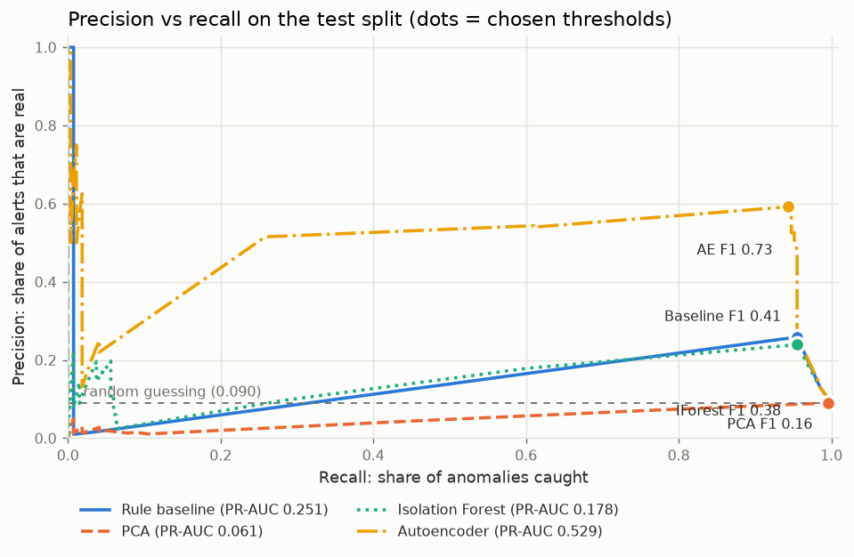
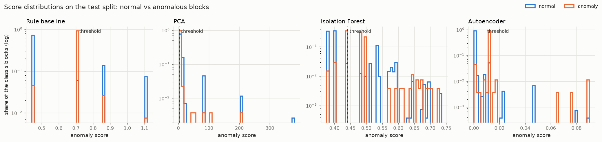

# Results: auth

Generated by `logad evaluate` on 2026-11-11.

- Models were trained on the **train** split (oldest 60% of blocks) **without labels**.
- Each model's alert threshold is the one with the best F1 on the **validation** split
  (next 20%). This is the only place labels influence the system.
- Results below are on the **test** split (newest 20%: 2,961 blocks, 267 anomalous = 9.02%), evaluated once.
- Brackets: 95% bootstrap confidence intervals (1,000 resamples of the test set).

| Model | Precision | Recall | F1 | Caught | False alarms | Missed | ROC-AUC | PR-AUC |
|-------|----------:|-------:|---:|-------:|-------------:|-------:|--------:|-------:|
| Rule baseline | 0.259 [0.229–0.286] | 0.955 [0.927–0.978] | **0.407** [0.369–0.440] | 255 | 731 | 12 | 0.748 | 0.251 |
| PCA | 0.090 [0.080–0.100] | 0.996 [0.988–1.000] | **0.165** [0.148–0.182] | 266 | 2,694 | 1 | 0.089 | 0.061 |
| Isolation Forest | 0.239 [0.213–0.264] | 0.955 [0.927–0.978] | **0.382** [0.348–0.415] | 255 | 812 | 12 | 0.728 | 0.178 |
| Autoencoder | 0.593 [0.543–0.638] | 0.944 [0.917–0.969] | **0.728** [0.688–0.764] | 252 | 173 | 15 | 0.936 | 0.529 |

Best F1 on test: **Autoencoder** (0.728). Where two models' F1 intervals overlap, the test set can't tell them apart reliably.

Thresholds (chosen on validation, in `artifacts/.../thresholds.json`):

- Rule baseline: 0.7072 (validation F1 0.295)
- PCA: 2.926 (validation F1 0.116)
- Isolation Forest: 0.441 (validation F1 0.277)
- Autoencoder: 0.008782 (validation F1 0.635)

## Caught per attack type (test split)

Groups (IP × window) containing each attack type, and how many each model flagged.

| Attack | Groups | Rule baseline | PCA | Isolation Forest | Autoencoder |
|--------|-------:|-----:|-----:|-----:|-----:|
| distributed | 237 | 237 (100%) | 237 (100%) | 237 (100%) | 237 (100%) |
| password_spray | 9 | 9 (100%) | 8 (89%) | 9 (100%) | 7 (78%) |
| compromise | 9 | 5 (56%) | 9 (100%) | 5 (56%) | 4 (44%) |
| account_takeover | 8 | 0 (0%) | 8 (100%) | 0 (0%) | 0 (0%) |
| brute_force | 4 | 4 (100%) | 4 (100%) | 4 (100%) | 4 (100%) |

