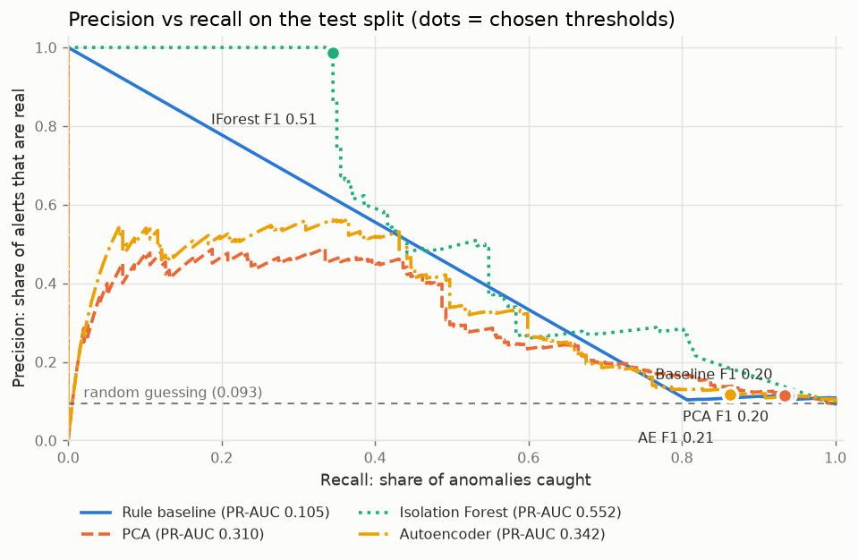
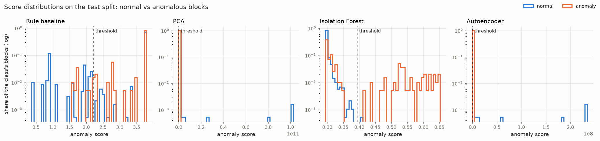

# Results: bgl

Generated by `logad evaluate` on 2026-11-11.

- Models were trained on the **train** split (oldest 60% of blocks) **without labels**.
- Each model's alert threshold is the one with the best F1 on the **validation** split
  (next 20%). This is the only place labels influence the system.
- Results below are on the **test** split (newest 20%: 2,111 blocks, 197 anomalous = 9.33%), evaluated once.
- Brackets: 95% bootstrap confidence intervals (1,000 resamples of the test set).

| Model | Precision | Recall | F1 | Caught | False alarms | Missed | ROC-AUC | PR-AUC |
|-------|----------:|-------:|---:|-------:|-------------:|-------:|--------:|-------:|
| Rule baseline | 0.115 [0.100–0.130] | 0.939 [0.904–0.969] | **0.205** [0.180–0.229] | 185 | 1,423 | 12 | 0.562 | 0.105 |
| PCA | 0.115 [0.099–0.130] | 0.934 [0.895–0.965] | **0.204** [0.178–0.228] | 184 | 1,420 | 13 | 0.778 | 0.310 |
| Isolation Forest | 0.986 [0.957–1.000] | 0.345 [0.279–0.410] | **0.511** [0.434–0.580] | 68 | 1 | 129 | 0.825 | 0.552 |
| Autoencoder | 0.118 [0.101–0.134] | 0.863 [0.812–0.908] | **0.207** [0.180–0.232] | 170 | 1,274 | 27 | 0.771 | 0.342 |

Best F1 on test: **Isolation Forest** (0.511). Where two models' F1 intervals overlap, the test set can't tell them apart reliably.

Thresholds (chosen on validation, in `artifacts/.../thresholds.json`):

- Rule baseline: 2.211 (validation F1 0.283)
- PCA: 7695 (validation F1 0.209)
- Isolation Forest: 0.3932 (validation F1 0.685)
- Autoencoder: 0.361 (validation F1 0.279)

