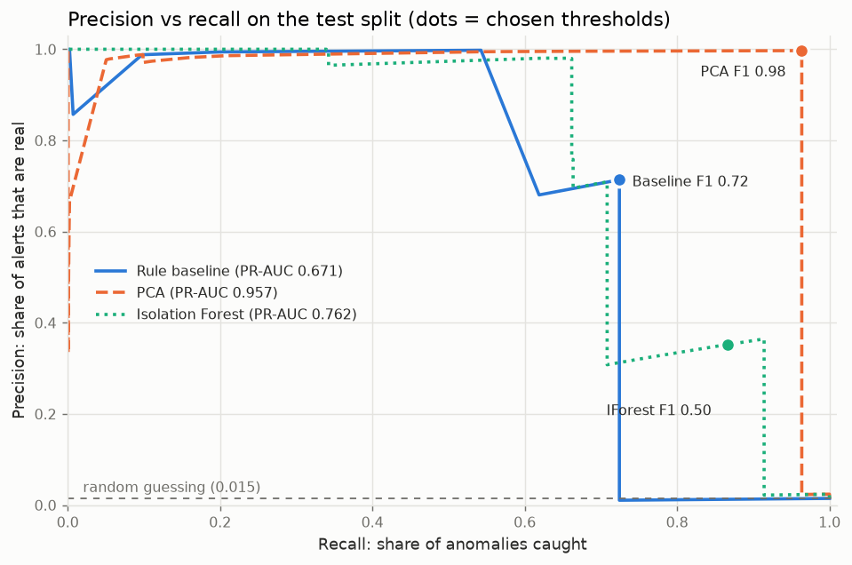
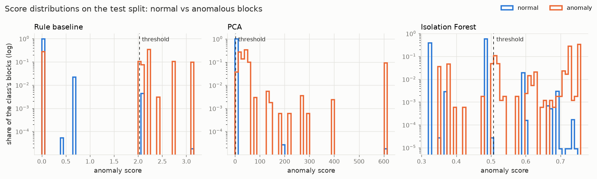

# Results: hdfs

Generated by `logad evaluate` on 2026-11-09.

- Models were trained on the **train** split (oldest 60% of blocks) **without labels**.
- Each model's alert threshold is the one with the best F1 on the **validation** split
  (next 20%). This is the only place labels influence the system.
- Results below are on the **test** split (newest 20%: 115,012 blocks, 1,679 anomalous = 1.46%), evaluated once.
- Brackets: 95% bootstrap confidence intervals (1,000 resamples of the test set).

| Model | Precision | Recall | F1 | Caught | False alarms | Missed | ROC-AUC | PR-AUC |
|-------|----------:|-------:|---:|-------:|-------------:|-------:|--------:|-------:|
| Rule baseline | 0.714 [0.692–0.734] | 0.724 [0.702–0.745] | **0.719** [0.700–0.735] | 1,216 | 488 | 463 | 0.724 | 0.671 |
| PCA | 0.997 [0.994–0.999] | 0.964 [0.954–0.972] | **0.980** [0.975–0.985] | 1,618 | 5 | 61 | 0.978 | 0.957 |
| Isolation Forest | 0.352 [0.339–0.366] | 0.866 [0.849–0.882] | **0.501** [0.486–0.516] | 1,454 | 2,673 | 225 | 0.943 | 0.762 |

Best F1 on test: **PCA** (0.980). Where two models' F1 intervals overlap, the test set can't tell them apart reliably.

Thresholds (chosen on validation, in `artifacts/.../thresholds.json`):

- Rule baseline: 2.027 (validation F1 0.898)
- PCA: 2.223 (validation F1 0.901)
- Isolation Forest: 0.5079 (validation F1 0.825)

